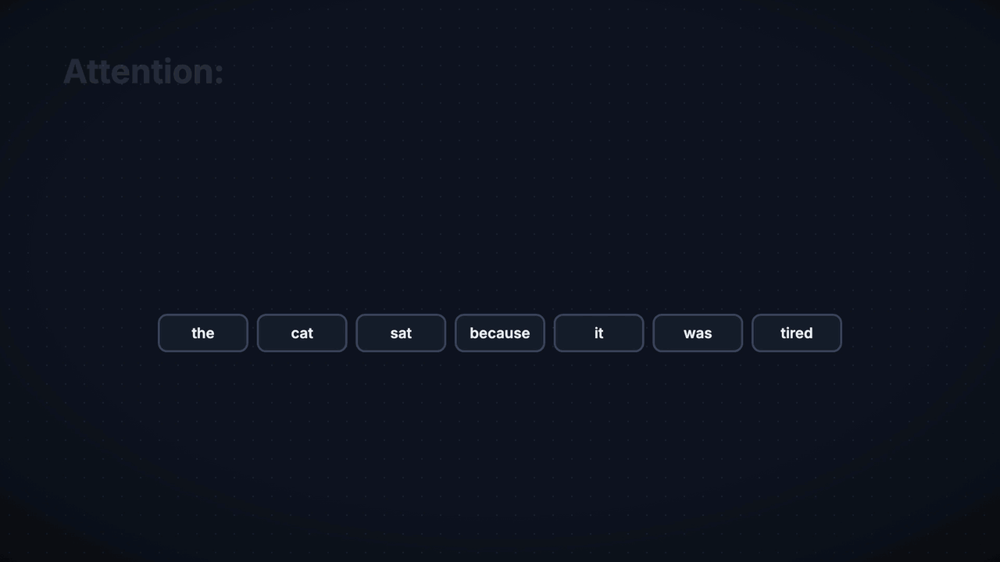

# anim

anim lets AI agents make narrated explainer videos. An agent writes each scene as JSON and ties every animation to a word in the script. anim voices the script, syncs the animations to it, and renders an MP4.

Several agents can work on one video at once, each writing a 10-second section. `anim lint` checks that the sections join cleanly, and an eval harness measures how well the agents do.



*A 12-second excerpt from Transformers in 60 seconds, made with anim from [videos/transformers-60s](videos/transformers-60s). [Watch the full video](https://github.com/keithagroves/anim/releases/download/examples/transformers-60s.mp4) with narration and music.*

## Install

```sh
npm install -g github:keithagroves/anim
anim setup     # Chromium for rendering, and the narration env if uv is installed
```

Requirements:

- Node 22+
- ffmpeg and ffprobe on `PATH`
- [uv](https://docs.astral.sh/uv/) for narration (Kokoro speaks the script, faster-whisper times each word)
- Optional:
  - Chatterbox in its own venv, to narrate in a cloned voice (set `CHATTERBOX_PYTHON`)
  - [Ollama](https://ollama.com), to grade agent output with local models (`OLLAMA_HOST`)
  - the `claude` CLI, for `anim gen` and for grading with Claude (paid)

To work on anim itself, clone the repo and link it instead, so `anim` runs your checkout:

```sh
npm install && npm link && anim setup
```

## Quick start

Run these from any folder; video paths are relative to it.

```sh
anim types                                  # the video types and what each is for
anim new explainer videos/my-video --title "What is a CPU cache?"
anim voice videos/my-video                  # narration.txt → vo.wav + vo.words.json
anim lint videos/my-video                   # validate, compile and lint every scene
anim sheet videos/my-video --scene 01-main  # contact sheet of keyframes
anim preview videos/my-video                # live player
anim render videos/my-video                 # → videos/my-video/out/video.mp4
anim videos                                 # catalog of ./videos
```

`anim help` lists the commands; `anim help <command>` (or `anim <command> --help`) shows its options and an example. The commands that generate and grade agent work (`anim eval`, `anim gen`, `anim monitor`) need a clone of this repo, because they store their cases, runs and traces in it.

## Layout

| Path | What it holds |
| --- | --- |
| `src/engine/` | Scene compiler, layout, timing, presets, lint, painter |
| `bin/anim.js` | The installed `anim` command (runs `src/cli/` through tsx) |
| `src/cli/` | The CLI's commands |
| `src/browser/` | The player and the frame renderer that Playwright drives |
| `src/score/` | Music and foley synthesis from `score.json` |
| `src/evals/` | Eval harness, judges, traces, monitoring |
| `video-types/` | Diagram, explainer and product-tour: guides, styles, scaffolds |
| `videos/` | Example videos (sources only; run `voice` and `render` to rebuild the audio and video) |
| `docs/` | Scene format, motion rules, looks, theme, score, evals |
| `evals/` | Gold cases, judge prompts, rubric |
| `canvas/` | tldraw app that draws diagram scenes live (`cd canvas && npm install && npm run dev`) |
| `vo/` | Python scripts for text-to-speech (Kokoro, Chatterbox) and speech recognition |
| `notes/` | Design plans and pre-registered experiments |

## Docs

- [Scene format](docs/format.md): the reference that agents follow when they write a section
- [Motion](docs/motion.md): timing rules, each stated as a number
- [Looks](docs/looks.md) and [Theme](docs/theme.md): palettes and backdrops
- [Score](docs/score.md): music and foley
- [Evals](docs/evals.md): gold cases, judges, traces, A/B runs

## Example videos

Generated audio (`*.wav`) and renders are not checked in. To rebuild an example, run `voice`, then `score` if the scene has a `score.json`, then `render`.

## Credits

Many of the motion rules in [docs/motion.md](docs/motion.md) came from studying films made with Claude Motion.

## License

[MIT](LICENSE)
